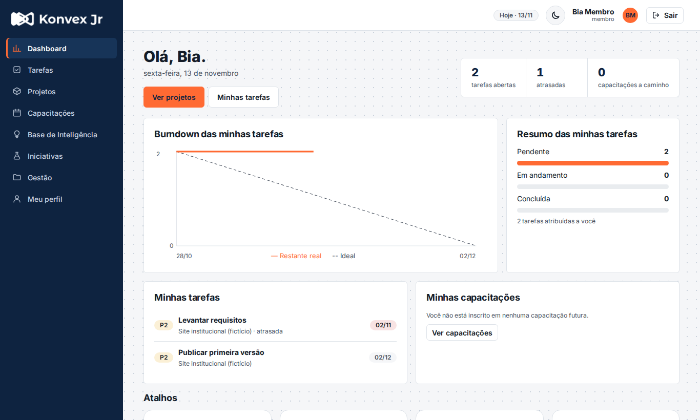
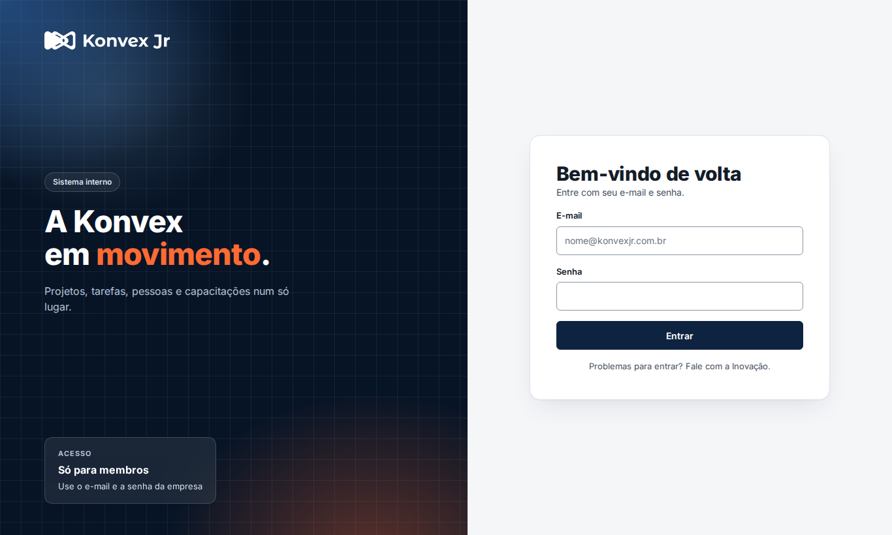
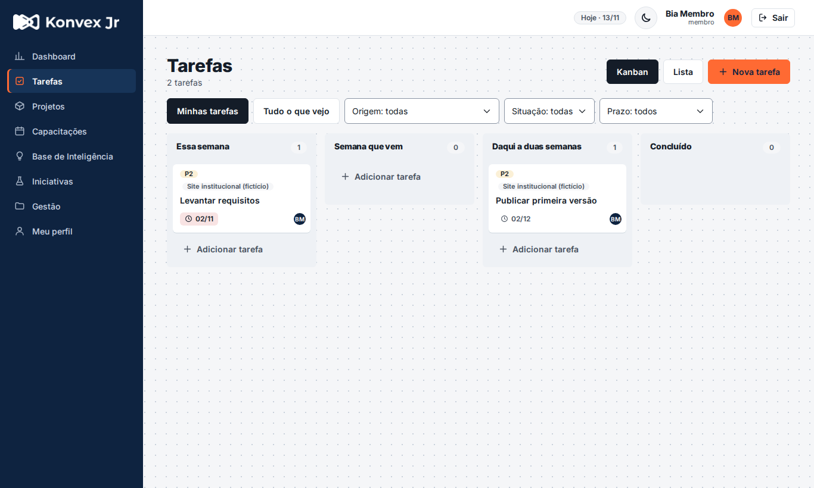
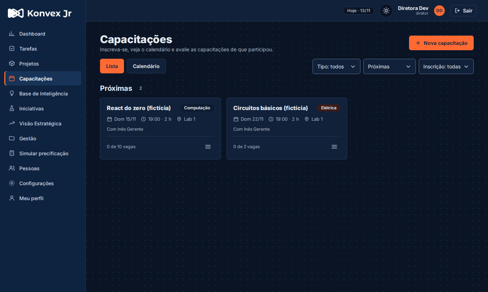
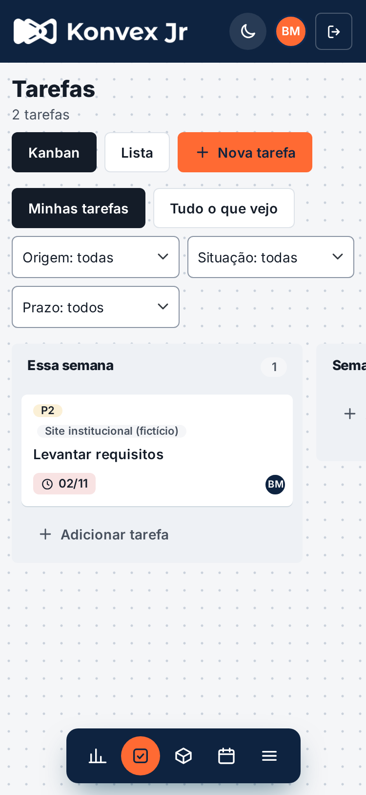

# Sistema interno da Konvex Jr. · Frontend

Interface web do ERP interno da Konvex Jr.: projetos, tarefas, pessoas, capacitações, documentos e indicadores num só lugar. Em produção em https://erp.konvexjr.com.br.

React 18 · Vite 7 · Bootstrap 5 · SweetAlert2. A API fica no repositório [BackendProjetosERP](https://github.com/Konvex-Jr/BackendProjetosERP).



| Login | Tarefas (kanban) |
| --- | --- |
|  |  |
| **Tema escuro** | **Celular (375 px)** |
|  |  |

> Todas as capturas usam dados fictícios (`npm run dados:ficticios` no backend). Para refazê-las: `npm run capturas`.

## Sumário
1. [Rodar na sua máquina](#1-rodar-na-sua-máquina)
2. [Comandos](#2-comandos)
3. [Como o código está organizado](#3-como-o-código-está-organizado)
4. [Qualidade: testes, CI e desempenho](#4-qualidade-testes-ci-e-desempenho)
5. [Publicação](#5-publicação)
6. [Licença](#6-licença)

## 1. Rodar na sua máquina
Precisa de Git, Node.js 20+ e da API rodando. O jeito mais rápido de subir a API é o `npm run dev:docker` do backend (veja o [README do backend](https://github.com/Konvex-Jr/BackendProjetosERP#1-subir-na-sua-máquina)).

```bash
git clone https://github.com/Konvex-Jr/FrontendProjetosERP.git
cd FrontendProjetosERP
npm ci
VITE_API_URL=http://localhost:5001 npx vite      # http://localhost:5173
```

Entre com a diretora `dev@konvexjr.com.br` / `konvex-dev`, ou com `ines@`, `bia@` ou `caio@dev.konvex` / `Konvex123` (gerente, membro líder, membro).

- A URL da API também pode ficar num `.env` (`cp .env.example .env`).
- Subiu a API em outra porta (`KONVEX_API_PORTA=5002`)? Use `VITE_API_URL=http://localhost:5002`. O frontend precisa estar em `localhost:5173` ou `localhost:4173`, as origens que a API de desenvolvimento aceita (CORS).

## 2. Comandos
| Comando | O que faz |
| --- | --- |
| `npm run dev` | Servidor de desenvolvimento (Vite) |
| `npm run build` | Build de produção em `dist/` |
| `npm test` | Testes das funções puras (`test/`, `node --test`) |
| `npm run lint` / `npm run format:check` | ESLint e Prettier (o CI cobra os dois) |
| `npm run format` | Formata tudo com o Prettier |
| `npm run e2e` | Levantamento no navegador: 3 papéis, todas as telas, desktop e celular |
| `npm run capturas` | Refaz as capturas deste README em `docs/capturas/` |
| `npm run orcamento` | Confere o tamanho do `dist/` (roda no CI) |
| `npm run desempenho` | Lighthouse na tela de login |

`e2e`, `capturas` e `desempenho` precisam do Playwright, que não é dependência do projeto: `npm i -g playwright && npx playwright install chromium` (ou instale numa pasta à parte e rode com `NODE_PATH=<pasta>/node_modules`).

## 3. Como o código está organizado
```
src/
  App.jsx          rotas (HashRouter), todas as páginas com lazy()
  pages/           uma tela por arquivo (Tarefas.jsx, Projetos.jsx...)
  components/      Layout, Table, FormModal, KanbanTarefas, Anexos...
  services/        um arquivo por módulo da API (tarefas.js, projetos.js...)
  lib/             funções puras com teste (indicadores, calendário, mapeadores)
  context/         sessão e dados compartilhados (AppContext)
  styles/          visual "Halo", claro e escuro; responsivo só em responsive.css
e2e/               levantamento, capturas e desempenho (Playwright)
test/              testes do node --test
```

Regras do dia a dia:
- **Cada módulo** tem `src/services/<modulo>.js` e uma tela que carrega dados com `useCarregar`. Listas usam o componente `Table`.
- **Permissões vêm da API.** O menu chega de `GET /auth/permissoes`, e cada item traz `podeAlterar`, `podeGerir` etc. A tela só obedece; a regra mora no backend.
- **Sessão:** o token vai no cabeçalho `access-token` e é renovado com `POST /auth/refresh`.
- **Erros e confirmações:** mostrar `error.message` (a API já diz qual campo está errado) e confirmar com `alerts.confirm` (`src/lib/alerts.js`).
- **Telas novas** nascem responsivas, no visual Halo, no tema claro e no escuro. Tela nova = item no registro do backend (`source/modulos/registro.ts`) + rota no `App.jsx` com `lazy()` + entrada no `NAV` + ícone.
- A tela "Simular precificação" é só uma simulação local: não grava nada na API.

## 4. Qualidade: testes, CI e desempenho
Todo PR roda no GitHub Actions (`.github/workflows/ci.yml`): lint, Prettier, testes, build e orçamento. A `main` só recebe mudanças por PR com o CI verde.

**Levantamento no navegador (`npm run e2e`).** Entra como diretora, gerente e membro e abre todas as telas do menu em 1366 px e 375 px. Falha com erro no console, "NaN" na tela ou rolagem horizontal, e guarda um print de cada tela em `e2e/prints/`. Precisa da API de desenvolvimento com dados fictícios (no backend: `npm run dev:docker && npm run dados:ficticios`).

**Orçamento (`npm run orcamento`).** Falha se o `dist/` passar destes limites, em gzip: `index.html` ≤ 2 KB, JS de entrada ≤ 85 KB (hoje ~69 KB), CSS ≤ 50 KB. Se estourar, quase sempre é algo pesado importado direto no pacote de entrada: as páginas usam `lazy()` (`src/lib/carregarPagina.js`) e o SweetAlert2 só é importado no primeiro alerta.

**Lighthouse (`npm run desempenho`).** Serve o `dist/` com os mesmos cabeçalhos do `nginx.conf` e mede a tela de login no perfil de celular. Mínimos: desempenho 90, acessibilidade 100, boas práticas 100. Precisa de `npm run build` antes e de um Chrome (`CHROME_PATH=...` se não for achado). Outro endereço: `APP_URL=https://... npm run desempenho`.

O sistema é interno e fica fora do Google (`public/robots.txt` com `Disallow: /` e `noindex` no `index.html`), por isso o Lighthouse não mede SEO.

## 5. Publicação
A imagem Docker (`Dockerfile`) faz o build com `VITE_API_URL` (padrão `http://localhost:5001`; em outro host, `--build-arg VITE_API_URL=https://...`) e serve o `dist/` com o `nginx.conf`: gzip, cache de 1 ano para arquivos com hash no nome, 7 dias para imagens e `no-cache` no `index.html`. A fonte Inter vem do pacote `@fontsource-variable/inter`, sem Google Fonts.

A publicação em produção é manual, na VPS, depois do merge, junto com o backend: passo a passo em `docs/PUBLICACAO.md` do [backend](https://github.com/Konvex-Jr/BackendProjetosERP/blob/main/docs/PUBLICACAO.md). Voltar o backend exige voltar o frontend junto.

Como contribuir (branches, commits, PR): [CONTRIBUTING.md do backend](https://github.com/Konvex-Jr/BackendProjetosERP/blob/main/CONTRIBUTING.md). As regras valem para os dois repositórios.

## 6. Licença
Uso proprietário da Konvex Jr. Veja [LICENSE](LICENSE).
